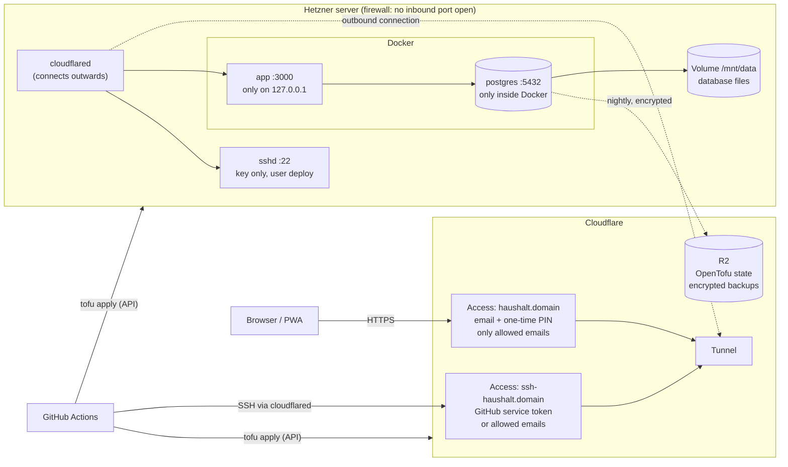

# Haushaltsbuch

Household budget app. Product concept: [docs/konzept.md](docs/konzept.md).

## Run locally

```bash
cp .env.example .env              # then set BETTER_AUTH_SECRET (openssl rand -base64 32)
docker compose up -d              # Postgres on localhost:5433
npm install
npm run db:migrate
npm run dev                       # http://localhost:3000
```

Locally there is no zero-trust provider. `.env.example` sets `AUTH_MODE=dev`, so `/sign-in` shows a
dev sign-in: one click signs you in as Max or Erika (see "Test data"), or as any email. There are no
passwords. On a server the app signs people in through Cloudflare Access instead; see
[Deployment](#deployment).

## Scripts

- `npm test` runs the Vitest suite (in-memory Postgres via PGlite, no Docker needed)
- `npm run db:generate -- --name <name>` creates a migration from the Drizzle tables
- `npm run db:migrate` applies migrations to `DATABASE_URL`
- `npm run db:seed` fills the local database with test data (see below)
- `npm run lint` runs ESLint, including the architecture boundaries

## Test data

`npm run db:seed` (after `npm run db:migrate`) creates a ready-to-use household from the concept:

| User | Email |
| --- | --- |
| Max Mustermann | `max@example.test` |
| Erika Mustermann | `erika@example.test` |

Sign in as either with the buttons on `/sign-in` (dev sign-in).

Both are members of the household "Mustermann". Max has a private ING Giro and a private Trade
Republic (clearing account and depot); there is a shared ING Gemeinschaftskonto, and Erika has a
private Girokonto and a private Erika ING Giro. Four test files are imported the same way an upload
does (rules, then transfer matching):

| File | Account | Balance afterwards |
| --- | --- | --- |
| `test-data/ing_testdaten.csv` | ING Giro (Max) | 703,26 € |
| `test-data/traderepublic_testdaten.csv` | Trade Republic clearing account (Max) | |
| `test-data/ing_gemeinschaftskonto_testdaten.csv` | ING Gemeinschaftskonto (shared) | 2.008,13 € |
| `test-data/ing_erika_testdaten.csv` | Erika ING Giro (Erika) | 4.252,21 € |

The shared file has the household's costs (rent, Kita, groceries, a holiday in Italy) from May to
October 2026; Erika's file her salary and personal spending from July. Their contributions to the
shared account and Erika's "Anteil Urlaub" to Max are linked as transfers.

The seed only adds data. If one of the two users already exists it refuses and changes nothing. To
seed again, reset the database `DATABASE_URL` points to (with the Compose setup:
`docker compose down -v`, `docker compose up -d`, `npm run db:migrate`); never point it at a
database you want to keep. The script reads `.env`, so `BETTER_AUTH_URL` must match the port the
dev server runs on.

## Deployment

Every push to `main` puts the new version online by itself: GitHub Actions runs the checks, creates
or updates the server and Cloudflare with OpenTofu, builds the app, and starts it on the server. Only
the people on your email list can open the app. Before the first push you set up a few accounts and
keys by hand once ([TODO list](#todo-one-time-setup)); after that nothing is manual.

Files: [`infra/`](infra) (server and Cloudflare as code), [`deploy/`](deploy) (what runs on the
server), [`Dockerfile`](Dockerfile), [`.github/workflows/deploy.yml`](.github/workflows/deploy.yml).
Background and privacy notes: [docs/deployment.md](docs/deployment.md).

### How it fits together



How a request gets in: the browser talks only to Cloudflare. Cloudflare Access asks for the email
and sends a one-time PIN; only emails on your list get through. The request then travels through the
tunnel, a connection the server itself opened **outwards** to Cloudflare, so the server needs no open
port. On the server, `cloudflared` hands it to the app on `127.0.0.1:3000`. The app checks Cloudflare's
signed login token again before it shows anything (`AUTH_MODE=identity`).

GitHub reaches the server the same way: `cloudflared access ssh` shows Access a service token that
OpenTofu created, then SSH logs in with the deploy key.

| Port | Listens on | Reachable from the internet? |
| --- | --- | --- |
| 22 (SSH) | server | No. The Hetzner firewall blocks it. Only through the tunnel + Access + key. |
| 3000 (app) | 127.0.0.1 only | No. Only `cloudflared` on the same server reaches it. |
| 5432 (Postgres) | Docker network only, no published port | No. Only the app and migrate containers reach it. |
| anything else | – | No. The firewall has no inbound rule at all. |

Outbound traffic stays open: `cloudflared` to Cloudflare, Docker pulls from `ghcr.io`, Ubuntu updates
(installed automatically), backups to R2.

What else is shut off:
- Postgres: the app connects as `haushaltsbuch`, the database's owner but **not** a superuser. Inside,
  row-level security keeps private accounts private (see CLAUDE.md).
- SSH: no passwords, no root login, only the user `deploy`.
- Secrets: never in the repository and never in the OpenTofu state. They live in GitHub secrets and
  your password manager, and on the server in files only `deploy` can read.
- OpenTofu state: encrypted before it is stored in R2 (it holds the tunnel and service tokens).
- Backups: encrypted on the server before upload; R2 only ever sees ciphertext.

### What it costs

| Item | Per month |
| --- | --- |
| Hetzner CX23 (2 vCPU, 4 GB RAM, 40 GB disk) | about 5,49 € |
| IPv4 address (needed: `ghcr.io` has no IPv6) | about 0,50 € |
| Hetzner volume, 10 GB (database) | about 0,50 € |
| Cloudflare Zero Trust (free up to 50 users), tunnel, DNS | 0 € |
| Cloudflare R2 (free up to 10 GB) | 0 € |
| GitHub Actions and container registry (within the free amounts) | 0 € |
| Domain | about 10 € a year |

Hetzner raised prices in 2026; check the current ones in the Hetzner console. If CX23 cannot be
ordered, set the GitHub variable `SERVER_TYPE` (e.g. `cx33`). An ARM type (`cax11`) also needs the
image built for `linux/arm64` in the workflow.

### TODO: one-time setup

Do these in order. Each step says why it is needed. Put every key and token you create into your
password manager right away, in one entry "Haushaltsbuch production".

**Hetzner**

- [ ] **1. Hetzner account and project.** [console.hetzner.com](https://console.hetzner.com): sign up,
  then **New project** → `haushaltsbuch`. *Why:* OpenTofu creates the server in this project.
- [ ] **2. Hetzner API token.** In the project: **Security → API tokens → Generate API token**,
  permission **Read & Write**. Save it as `HCLOUD_TOKEN`. *Why:* OpenTofu creates the server, volume
  and firewall with it.

**Cloudflare**

- [ ] **3. Domain at Cloudflare.** [dash.cloudflare.com](https://dash.cloudflare.com) → **Add a
  domain**, free plan, then change the nameservers at your registrar to the two Cloudflare shows.
  Wait until Cloudflare says the domain is **Active** (minutes to hours). *Why:* the tunnel and Access
  only work for domains whose DNS is at Cloudflare. Save the domain as `DOMAIN` (e.g. `example.com`).
- [ ] **4. Account ID.** On the domain's **Overview** page, right column, **Account ID**. Save it as
  `CLOUDFLARE_ACCOUNT_ID`.
- [ ] **5. Zero Trust.** Left menu **Zero Trust**. Choose a **team name** (e.g. `finckh`; it gives
  `https://<team>.cloudflareaccess.com`) and the **Free** plan (Cloudflare may ask for a payment
  method; the free plan costs nothing). Save the team name as `ACCESS_TEAM`. *Why:* Access is the
  login in front of the app.
- [ ] **6. Login method.** Zero Trust → **Settings → Authentication → Login methods**: make sure
  **One-time PIN** is listed (else **Add new → One-time PIN**). *Why:* people sign in with a code sent
  to their email. Google or GitHub login can be added here too.
- [ ] **7. Data processing agreements (AVV).** Cloudflare: its
  [Customer DPA](https://www.cloudflare.com/cloudflare-customer-dpa/) is part of the terms; keep a copy.
  Hetzner: Console → your account → **Data protection / Auftragsverarbeitung**, conclude the AVV.
  *Why:* the concept asks for an AVV with every provider that handles the data (docs/deployment.md,
  "Privacy").
- [ ] **8. Cloudflare API token for OpenTofu.** Profile icon → **My Profile → API Tokens → Create
  Token → Create Custom Token**, name `haushaltsbuch-opentofu`, permissions:
  - Account · **Cloudflare Tunnel** · Edit
  - Account · **Access: Apps and Policies** · Edit
  - Account · **Access: Service Tokens** · Edit
  - Account · **Workers R2 Storage** · Edit
  - Zone · **DNS** · Edit, and Zone · **Zone** · Read, both for your domain only

  Save it as `CLOUDFLARE_API_TOKEN`. *Why:* OpenTofu creates the tunnel, the two addresses, the login
  rules and the backup clean-up with it.
- [ ] **9. Two R2 buckets.** Left menu **R2 Object Storage** (activate it; free tier). **Create
  bucket** twice, location Europe (or automatic):
  - `haushaltsbuch-state`, save the name as `R2_STATE_BUCKET`. *Why:* OpenTofu stores what it created
    here, so every run knows the current state.
  - `haushaltsbuch-backups`, save the name as `R2_BACKUP_BUCKET`. *Why:* nightly database backups.
- [ ] **10. Two R2 keys.** R2 → **Manage API tokens → Create API token**, twice:
  - `haushaltsbuch-state`: **Object Read & Write**, only bucket `haushaltsbuch-state`. Save
    **Access Key ID** / **Secret Access Key** as `R2_STATE_ACCESS_KEY_ID` / `R2_STATE_SECRET_ACCESS_KEY`.
  - `haushaltsbuch-backups`: **Object Read & Write**, only bucket `haushaltsbuch-backups`. Save as
    `R2_BACKUP_ACCESS_KEY_ID` / `R2_BACKUP_SECRET_ACCESS_KEY`.

  *Why two:* the server only gets the backup key. If the server were ever compromised, the state
  bucket stays out of reach.

**GitHub**

- [ ] **11. Let the repository read the change-map package.** Open the package `@jfinckh/change-map`
  (github.com → your profile → **Packages** → `change-map`) → **Package settings → Manage Actions
  access → Add repository** → `Haushaltsbuch`, role **Read**. *Why:* it is a dev dependency from
  GitHub Packages; without this, `npm ci` in the workflow fails with 401.

**Keys you make on your computer**

- [ ] **12. Make the keys.** In a terminal (each command prints one value; save each under its name):

  ```bash
  openssl rand -base64 32            # BETTER_AUTH_SECRET
  echo "1:$(openssl rand -base64 32)"  # FIELD_ENCRYPTION_KEYS
  openssl rand -base64 32            # BLIND_INDEX_KEY
  openssl rand -hex 32               # STATE_PASSPHRASE
  openssl rand -hex 32               # BACKUP_PASSPHRASE
  ssh-keygen -t ed25519 -N "" -C haushaltsbuch-deploy -f ~/.ssh/haushaltsbuch-deploy
  ```

  The last one makes the SSH key pair: `~/.ssh/haushaltsbuch-deploy` (private, `SSH_PRIVATE_KEY`) and
  `~/.ssh/haushaltsbuch-deploy.pub` (public, `SSH_PUBLIC_KEY`).

  **Losing a key:** `FIELD_ENCRYPTION_KEYS` and `BLIND_INDEX_KEY` lost = IBANs, names and references
  unreadable for good. `BACKUP_PASSPHRASE` lost = backups unreadable. `STATE_PASSPHRASE` lost = OpenTofu
  cannot read its state any more. So: password manager, now.

- [ ] **13. GitHub environment.** Repository → **Settings → Environments → New environment** →
  `production`. Add the **secrets** (Environment secrets → Add secret):

  | Secret | Value from step |
  | --- | --- |
  | `HCLOUD_TOKEN` | 2 |
  | `CLOUDFLARE_API_TOKEN` | 8 |
  | `R2_STATE_ACCESS_KEY_ID`, `R2_STATE_SECRET_ACCESS_KEY` | 10 |
  | `R2_BACKUP_ACCESS_KEY_ID`, `R2_BACKUP_SECRET_ACCESS_KEY` | 10 |
  | `BETTER_AUTH_SECRET`, `FIELD_ENCRYPTION_KEYS`, `BLIND_INDEX_KEY` | 12 |
  | `STATE_PASSPHRASE`, `BACKUP_PASSPHRASE` | 12 |
  | `SSH_PRIVATE_KEY` | 12, the whole content of `~/.ssh/haushaltsbuch-deploy` |

  And the **variables** (Environment variables → Add variable; not secret):

  | Variable | Example | From step |
  | --- | --- | --- |
  | `DOMAIN` | `example.com` | 3 |
  | `CLOUDFLARE_ACCOUNT_ID` | `0123abcd…` | 4 |
  | `ACCESS_TEAM` | `finckh` | 5 |
  | `R2_STATE_BUCKET` | `haushaltsbuch-state` | 9 |
  | `R2_BACKUP_BUCKET` | `haushaltsbuch-backups` | 9 |
  | `SSH_PUBLIC_KEY` | `ssh-ed25519 AAAA… haushaltsbuch-deploy` | 12 |
  | `ALLOWED_EMAILS` | `["you@example.com","partner@example.com"]` (JSON list) | – |
  | `SERVER_TYPE` (optional) | `cx23` (default) | – |
  | `SERVER_LOCATION` (optional) | `nbg1` (default), `fsn1`, `hel1` | – |
  | `APP_SUBDOMAIN` (optional) | `haushalt` (default) | – |

  *Why an environment:* the secrets are only handed to the job that deploys, not to every workflow.
  Optional: under the environment, **Deployment branches → Selected branches → `main`**.

**First deploy**

- [ ] **14. Push to `main`** (or **Actions → Deploy → Run workflow**). The first run takes about
  10–15 minutes: the server boots and installs Docker and `cloudflared` (cloud-init) while the images
  build. Later runs take a few minutes.
- [ ] **15. Check.** Open `https://haushalt.<domain>` in a private window: Cloudflare's login page comes
  first. Sign in with an allowed email and the PIN: the app opens and creates your user. Another email
  gets no PIN. Sign out in the app: you land on Cloudflare's "logged out" page. Then invite your
  partner from the app as usual.
- [ ] **16. Install `cloudflared` locally** (`brew install cloudflared`) and add this to
  `~/.ssh/config`, so you can reach the server yourself (see below):

  ```
  Host haushaltsbuch
    HostName ssh-haushalt.<domain>
    User deploy
    IdentityFile ~/.ssh/haushaltsbuch-deploy
    ProxyCommand cloudflared access ssh --hostname %h
  ```

### What happens on every push to main

| Job | What it does |
| --- | --- |
| **check** | `npm ci`, ESLint (incl. architecture boundaries), TypeScript, Vitest. Nothing else runs if this fails. |
| **image** | Builds two images and pushes them to `ghcr.io/jfinckh/`: `haushaltsbuch` (the app) and `haushaltsbuch-migrate` (runs the SQL migrations), each tagged with the commit SHA. Keeps the newest 10. |
| **release** | 1. `tofu apply`: brings server, firewall, volume, tunnel, DNS and Access to what `infra/` describes (usually "no changes"). 2. SSH to the server through the tunnel. 3. Copies `deploy/` and writes the settings (`app.env`, `backup.env`) from the GitHub secrets. 4. `deploy.sh`: pull images, start Postgres, run migrations, start the new app, wait until it answers. 5. Turns on the nightly backup. 6. Checks from outside that the app address asks for a Cloudflare login. |

If a step fails, the job turns red and you get GitHub's email. Failed **migrations** stop before the
app is replaced: the old version keeps running. If the **new app** does not start, it is down until
you push a fix or roll back (below). The job log says which step failed.

### Operations

**Open a shell on the server.** `ssh haushaltsbuch` (step 16). The browser opens for the Cloudflare
login the first time. Everything lives in `/opt/haushaltsbuch`; the database files in `/mnt/data`.

**Logs.**
```bash
ssh haushaltsbuch 'cd /opt/haushaltsbuch && docker compose logs --tail 100 app'
```

**Roll back.** Actions → **Deploy → Run workflow**, field *image tag*: the SHA of an older commit
(one of the last 10). No build, just deploy. Database migrations are not undone; an older version
must work with the newer schema (keep migrations additive).

**Add or remove a person.** Change the variable `ALLOWED_EMAILS`, then run the workflow (or push).
Removing someone from the list locks them out at Cloudflare; their data stays in the app.

**Backups.** Every night at about 03:00 (German time) the server saves an encrypted dump to the
backup bucket; R2 deletes copies older than 30 days.
```bash
ssh haushaltsbuch /opt/haushaltsbuch/backup.sh list          # what is there
ssh haushaltsbuch /opt/haushaltsbuch/backup.sh run           # one now
ssh -t haushaltsbuch /opt/haushaltsbuch/backup.sh restore    # newest; or: restore <name>
ssh haushaltsbuch 'systemctl --user list-timers; journalctl --user -u haushaltsbuch-backup -n 20'
```
Restore stops the app, replaces the whole database with the backup and starts the app again. It asks
before it does anything. Try it once early, so you know it works.

**Rebuild the server** (e.g. after changing `infra/cloud-init.yaml`, or a broken system): Actions →
**Deploy → Run workflow**, tick *Replace the Hetzner server*. The volume with the database is kept and
mounted on the new server; the database passwords are stored on it too.

**Change the server type.** Set `SERVER_TYPE` and run the workflow. Hetzner resizes the server (it
restarts once).

**Rotate the GitHub service token** (valid 10 years): run `tofu apply
-replace=cloudflare_zero_trust_access_service_token.deploy` (needs a local OpenTofu with the same
settings as the workflow), or delete it in Zero Trust → Access → Service auth; the next run makes a new one.

**If SSH through the tunnel does not work** (e.g. `cloudflared` stopped): the Hetzner console has a
**Rescue** system and a web console. The app keeps working as long as `cloudflared` and Docker run.

## Auth module

`src/auth` is self-contained and reusable. Use it only through its entry points:

- `@/auth` (browser-safe): `DevSignIn`, `SignOutButton`, `InviteShareButton`, `InviteAcceptance`, `useSession`, `SessionUser`
- `@/auth/server`: `createAuth({ db, secret, baseURL, mode, invitePath?, inviteTtlSeconds? })` returns `{ handler, api, mode, getSession, requireSession, signInUrl, signOutRedirect, devSignIn, getInviter, getUserNames, userExists, ensureUserSession }`; `authTables` for Drizzle

There is no email and password. Better Auth keeps users, sessions and cookies; how a session starts
depends on `AUTH_MODE`:

- **`identity`** (also when `AUTH_MODE` is unset): a zero-trust proxy (Cloudflare Access) has signed
  the person in and sends a signed token with every request (`Cf-Access-Jwt-Assertion`). The app
  checks its signature, issuer, audience and expiry (`IDENTITY_ISSUER`, `IDENTITY_JWKS_URL`,
  `IDENTITY_AUDIENCE`, optional `IDENTITY_JWT_HEADER`). `/sign-in` redirects to
  `GET /api/auth/identity/sign-in`, which finds the user by email (or creates it on the first visit)
  and starts a session. A session counts only while the token belongs to the same person: no token,
  or a token for someone else, means signed out. The plain email header is never trusted.
  Sign-out also ends the provider's login (`IDENTITY_LOGOUT_URL`, default `/cdn-cgi/access/logout`).
- **`dev`**: the local dev sign-in (`POST /api/auth/dev/sign-in`). The app refuses to start with it
  unless all three hold: `AUTH_MODE=dev`, `NODE_ENV=development` (`next dev`; `next build` and
  `next start` set production) and `BETTER_AUTH_URL` on `localhost`, `127.0.0.1` or `*.localhost`.
  Forgetting a setting never turns it on.

The email identifies the user. A new email at the provider means a new, empty user; moving data to
it is manual. The name is set on the first visit (the token's name, else the part of the email
before "@") and later tokens do not change it.

Invite links are single-use and valid for 7 days. `GET /api/auth/invite/inviter` returns who invited the signed-in user.
